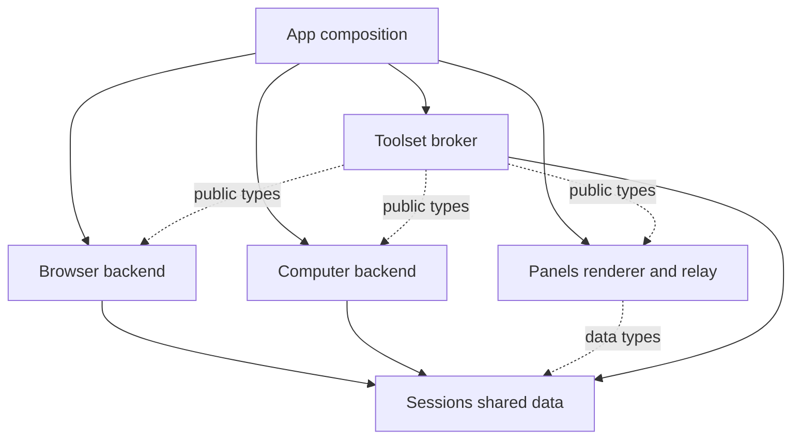

## Proposal status

These are the contracts for ADR-0023 to ADR-0027. Parts have landed, and the code and module READMEs win where this draft differs: the session automation facts and their event fold in `src/sessions/shared/`; the broker, activity, icon store, policy, scheduler and the five panel tools in `src/toolset/main/`; the UI ports and their fakes in `src/toolset/shared/`; the presentation contract, the window's rules and a fake window in `src/panels/shared/`, with the panel host in `src/panels/main/` and the window's side in `src/panels/renderer/`; each provider adapter's connection to the toolset and its delivery of presentation notices; `AutomationBridge` over the broker in `src/app/main/automation-ui.ts`; and the presentation and automation members of the preload bridge, which the window's activity uses for its presentations' Show. The browser, computer and control-window contracts remain proposals. Runtime consumers build on the fakes first.

## Authority and data

`src/sessions/shared/automation.ts` extends the provider-neutral session model with serializable automation facts. It imports only existing shared event types, including `PermissionMode`, `SandboxLevel`, `ApprovalAnswer` and `MessageImage`. It owns no policy or backend service. Browser/computer contracts can therefore depend on this leaf without depending on the toolset that calls them.

| Data | Required fields and meaning |
|---|---|
| Owner | App session identity allocated before provider startup; workspace and effective policy held in main, not selected by model arguments. |
| Access | Owner-bound transport generation, revocable independently of the durable session. Credentials never enter shared UI/model data. |
| Target | Opaque handle, kind and backend generation resolved through an owner-scoped registry. Titles, URLs and raw native IDs are not authority. A target's summary names its icon by ID rather than carrying the image; the UI reads the bytes by that ID, which a session may do only while one of its retained facts names it. |
| Observation | Target plus document/geometry generations, capture ID, viewport/image dimensions, coordinate units/transform and capture time; render time only when known. |
| Operation/grant | Owner, turn, target, operation kind, policy epoch, state and grant reference. A grant retains its own last-known target summary and summary time, apart from the live resource registry; its scope is operation or session, with issuance and end facts. |
| Tool call | Opaque call ID allocated after caller authentication but before target resolution, policy checks or operation creation; owner, turn, access generation, tool, target summary or unresolved request, sharing, delivery, nullable operation ID, outcome and its frames' metadata, whose image bytes are read by call. A panel call carries each presentation's ID, title, version and items, each with its content and its box, or null while its panel is closed, instead of a target, sharing and delivery. |
| Outcome | Verified, dispatched, refused, cancelled-before-dispatch, partial or indeterminate, with bounded data and a code. A refusal may carry a typed detail: an argument the model can correct, so far a missing or malformed `actionId` with why (`required`, `invalid-type`, `too-short` or `too-long`) but never the value it sent; the call's unmet setup requirement, an availability reason, the user's bounded deny message, or the window's refusal with the presentation's current state. Cancellation after dispatch never claims no effects. |
| Event/snapshot | Broker epoch, session ID and monotonically increasing sequence. Subscribe before snapshot, discard older buffered events, resnapshot on gaps or epoch change. A `state` event carries the live state only: policy, phase, resources, operations, grants, pending approvals, foreground owner and availability. A snapshot adds the retained history, which only its own events change: `tool-call` adds or replaces a record by its revision and `tool-call-removed` removes an evicted one, `grant-ended` adds an ended grant and `grant-end-removed` removes an evicted one, and `presentation-notices` replaces the pending notices. Every other event is news whose effect arrives in one of those. `sessions/shared/automation-state.ts` folds events by these rules. |

Execution contexts, leases and cancellation controllers stay in main. Shared types describe facts and do not prove authority. Images carry actual bounded bytes in MCP image content and repeat necessary geometry in model-visible structured/text output. A path alone does not establish image support. Preload may use bounded app-owned image resources with the same metadata, never arbitrary filesystem reads.

## Nine UI interfaces

The app's `Bridge` gains feature-owned automation, browser and computer ports. Panels owns its presentation extension. Every main handler validates the trusted app frame and membership; embedded sites and external pages receive none of these ports. Backend results use codes/data; the UI owns translated wording.

| Interface and proposed home | Snapshot/events | Commands/outcomes |
|---|---|---|
| Session automation, `toolset/shared/automation.ts` | Owner's resources, foreground owner, idle/observing/acting/waiting-grant/paused/stopping state; a refused call's record, not this state, names the setup it needs | Snapshot/subscription, a call's record and its frames' bytes on request, an icon's bytes by ID, stop and end operation. Epoch/sequence support reload and missed events. `window.bridge.automation` serves it to the app's main frame for the sessions the app has: subscriptions belong to the page and end with it, on unsubscribe, navigation, a lost renderer or a closed window; a session not yet bound refuses a snapshot until its first event; Stop also interrupts the provider's turn. |
| Browser tabs, `browser/shared/browser.ts` | Owner, sharing/profile/browser, title/address, document generation, loading/error, sign-in-needed or unknown, history, agent/user control | Navigate/back/forward/reload/stop-loading, take control/hand back and explicit Open, with expected target generation. Hand back may need a new approval. |
| Browser view host, same module | View binding/revision, bounds/scale, current/kept frame and failures, overlay/dimmer state, user-input/takeover events | Bind/show/hide/unbind without navigation; resize; cover/uncover for menu/question/drag; dim with UI-supplied color/opacity. Cover returns current frame, matching kept frame with age, or paper within 100 ms. A dimmer click is consumed and reported. Focus only follows a user action. |
| Computer/control, `computer/shared/computer.ts` | `ComputerBridge` supplies permitted applications/windows, previews, Secure Input and takeover/shortcut availability. `ControlWindowBridge` supplies the control window's identity, revision, visibility, foreground owner, display and stable bounds | Observe/preview/reveal/stop/take over/hand back. Main hosts the non-activating window; the renderer draws it and owns its words. Acting/paused changes preserve its position. A separate main-to-helper port supplies verified window identity and geometry for capture/input exclusion. Self-activation shows the control but grants no desktop input. |
| Presentation, `panels/shared/presentation.ts` | Renderer epoch, presentation version, title, owning session, where each open panel lies, and the sessions' own panels | Scoped ID/reuse-key present/update/arrange/close, each carrying the presentation version the agent last saw, and actual acknowledgement/refusal with the current state. Every change the agent's own command did not make reaches the agent as a notice, and `panel_list` returns the current state. A fresh present may reopen; update and old request replay cannot. The user's own reopening, from the activity's Show, is reported to the host under the window's own request ID, and the host presents it again, records the state the window answers with and answers the request with its outcome: shown, expired, held back by a panel's unsaved changes, busy, or unavailable, which the activity says beside Show; so is Show on the line above the composer, for a tab or application the session uses that no presentation shows, which names the resource for the host to present. The panels module's `shared/presentation.ts` holds the exact commands, answers and placement, with the window's rules and a fake window; no second layout model is introduced. `window.bridge.presentations` carries them between the panel host in main and the window's page, which main accepts only from the app's main frame that sent the page's first snapshot, a navigation, a lost renderer or a closed window ending the page, and reads an artifact for the page only while a retained or pending presentation names it. |
| Grants, common session model | Pending target/kind/risk; each grant carries the site, browser and profile ID/name, or application, even after removal from `resources`. End records retain that summary, end time and reason, including `tab-closed` and `application-quit` | Existing allow-once/allow-for-session/deny answers and End. Tag host vs provider request IDs so an answer cannot reach the wrong authority. Composer layout/settings remain unchanged. |
| Setup, feature shared ports | App profile; Chrome installed/minimum version, connection, extension state (`unknown`, `not-installed`, `disabled`, `enabled`) and version, connected profile ID/name or null; Safari's installed/minimum version, each Safari profile's ID/name, each role per profile and each role's website access; helper name, permissions, restart and conditional Input Monitoring | User-only connect/disconnect, exact setup step, clear app sign-ins or restart helper. Model calls are refused as `setup-required`, naming the unmet requirement; they cannot invoke setup commands. |
| Outcomes, common session model | `AutomationCallRecord` per browser, computer or panel call, its receipt and validated provider-entry link; target/sharing/delivery, typed outcome and frame metadata, including refusals without an operation. The record also keeps its approval with the answer, its time and the grant it made, its operation's and grant's endings, and its incidents, each with its time and operation: a target bringing itself forward, a dismissed dialog, takeover and Secure Input | Join the existing activity tool entry by the opaque call ID, expose the retained records in snapshots and owner-scoped lookups for a record and its frames' bytes. Report checked vs merely dispatched vs refused/stopped/uncertain. Unclassified input counts as human input. No automatic foreground fallback. |
| Tool availability, automation projection | Per-session transport/tools/images ready, unavailable or unknown, with a reason code and typed parameters | Capability lookup uses static/cached facts without starting browsers or prompting for permissions; missing optional setup does not disable unrelated tools. |

The canonical `previewFailureReasons` list, in `sessions/shared/automation.ts`, is `inactive-tab`, `page-binding-unverified`, `site-access-required`, `connection-lost`, `tab-closed`, `permission-required`, `target-state-unsupported` and `application-quit`. Browser, computer and UI contracts use that union; there is no second `target-closed` spelling. Capture time is distinct from render time. Unknown is not silently mapped to success, signed-out or denial.

Availability reasons are a discriminated union: `transport-unsupported` carries the transport; `image-input-unsupported` has no parameters; `os-version-unsupported` carries installed/minimum versions; `browser-version-unsupported` also names the browser; `backend-unavailable` names the backend; `extension-required` and `connection-required` name the browser; `not-probed` has no parameters. These are data for UI-owned translations, never backend-authored display sentences. Feature-specific setup problems leave unrelated tools available.

The control window is an app-owned Electron macOS panel. Verifying its Spaces, full-screen and non-activation behavior decides the host once, and the contract carries only the host chosen: the helper's native panel, which would receive its localized content from the UI through `ControlWindowBridge` rather than the model-facing computer port, is added only if the app's window fails that verification. Nothing switches hosts at runtime. The main-to-helper exclusion names the host-owned native window and process as well as its current geometry; the helper verifies ownership. A model-supplied rectangle cannot suppress human-input detection. Actual app-window behavior remains to be verified.

Direct user interaction and model authority use separate entry points. User navigation/focusing/Open controls do not let a model claim user provenance, and the session's agent sandbox does not prevent the user from manually using their page. The MCP execution port does not expose the user-only setup or focus methods.

An explicit application-discovery request may lazily start the signed helper in metadata-only mode, without window capture/input or a permission prompt. Permission queries must run under the helper's own identity when requested; until queried, report unknown or a dated prior observation rather than presenting the host process's permissions as the helper's.

## Tool-call activity correlation

Every authenticated browser, computer or panel invocation gets an `AutomationCallRecord` before policy or setup can refuse it. The record has a monotonically increasing revision, start/completion times and a phase, and contains a self-contained target summary when resolution succeeds. Otherwise it retains only the bounded, display-safe requested handle/address and target kind, explicitly unresolved. Sharing is the known/requested level or null, never guessed as none; delivery records the requested background/foreground mode, while the outcome says whether anything was dispatched. `operationId` is null until an operation exists. Neither that ID nor the tool name is the activity join key.

The tool result carries an `automation` receipt with `schemaVersion: 1` and the opaque `callId`. The registered toolset's structured result, and its machine-readable text envelope where the provider needs that fallback, carry the same receipt. A provider adapter normalizes it only from that toolset's outer tool-result envelope and native tool-entry metadata. It never searches arbitrary model prose, nested page content or unrelated tools' output for an ID. The host validates the receipt against its own record's owner, turn, access generation and canonical tool name, then binds the provider's existing native tool-entry ID. Missing or unverifiable provenance leaves the ordinary tool entry unjoined; it does not justify guessing by time or name. An ID in output is correlation data, not authority to execute or read another owner's records.

The host keeps this validated link with the call's record. Record and result may arrive in either order: a bounded pending join and owner-scoped record lookup reconcile them; unknown references time out without an automation row. Replayed receipts and older record revisions are idempotent. A different native entry cannot claim an already linked call, nor can two calls claim one entry. Snapshots expose the retained records and links, so renderer reload and provider reconnect do not lose completed activity. Records and image retention are bounded; eviction leaves an explicit unavailable image/record, never an unbounded cache or a fabricated result. `callRecord` reads the same retained records, not an archive, and the app keeps them in memory only: after a record's eviction or a restart of the app, the activity shows the provider's own tool entry, without screenshots, sharing, delivery or Show.

The UI augments the existing tool entry with target, sharing, delivery, outcome and frames, including `sandbox-denied` and `setup-required` before an operation, and a panel call's entry with its presentation, which Show presents again. It does not create a duplicate tool entry or append the same screenshot twice from the provider result and broker event, and it reads a call's frame bytes only for the entries it draws, and each icon once, by its ID. The record's observation IDs identify its authoritative frames. Frame bytes and geometry remain meaningful when the live target leaves `resources`; historical captures remain labeled with their capture time.

## Policy and lifetime

Default presentation is background, delivery is background and panel focus is preserve, independently of sharing. In auto, shared tabs, application observation, foreground input and system dialogs require their operation grant; none-sharing, metadata discovery and panels do not. Read-only refuses mutation/foreground before approval. Workspace-write checks canonical paths against workspace/owned temporary roots; yolo never bypasses these checks. The provider's own approval policy remains separate.

| Trigger | Required result |
|---|---|
| Turn end/Stop | Cancel actions and end operation grants; retain session grants, tabs and shared sign-ins. Retain exclusion until native settlement. |
| Human takeover | End operation, cancel queued work and give control to the user. Hand back starts a new operation under normal authority; a session grant may cover it. |
| Provider reconnect | Same app owner, new access generation; no uncertain mutation replay or transfer of another owner's targets. |
| Policy change | Increment policy epoch and recheck queued work; yolo-to-auto restores grant checks. |
| Session close/archive/removal | Revoke access/operations. Delete its none-sharing context; detach shared/external resources without closing pre-existing user tabs. Its presentations' states and pending notices go only with its removal. |
| Panel close | Detach preview only; raise the presentation's version and retain a notice for agent delivery. Terminal close still ends its program and is refused to models; files retain unsaved-change guards. |
| Target ends | End its grants/operations with `tab-closed` or `application-quit`, retaining last-known target summaries in the end records. Registry eviction alone does not erase a grant's display facts. |
| Renderer reload | New epoch and snapshot reconciliation; stale acknowledgements rejected, presentations' states and pending notices retained. |
| Backend restart | New generation; old observations/leases invalid. Persistent profile identity does not make an old observation current. |

Setup requires trusted user provenance, never a model-supplied Boolean. A target's own activation produces an event and floating control, without authorizing global input.

After any change to a presentation's state that the agent's own command did not make, such as the user closing, moving or resizing its panels, the layout around them changing, another presentation of the session taking its place, the user reopening it from the activity's Show or a window reload, the agent gets a notice of the presentation's latest state: owner, presentation/reuse IDs, title, version, items, which panels are open and where each lies. The agent needs where things stand, not how they came to be, so a notice holds no cause, time or history, and a later change replaces a pending notice for the same presentation. The host reports notices at the next opportunity, in the next toolset result or with the next turn, and `panel_list` returns the session's presentations as they are: each one's version and items, which panels are open and where each lies, and the session's own panels. Reading a snapshot/list or assembling a result does not consume a notice. A notice retires only once the provider's own record shows the result or turn that carried that version or a later one: the result's receipt joined to its provider tool entry, or the turn the provider accepted. A turn counts as accepted on the provider's own acknowledgement: Claude's echo of the message, Codex's response to starting the turn or steering it, including a by-message answer to its question, and Grok's response to the whole prompt; Grok's acknowledgement that it queued an interjection is not one, so those notices stay pending. A failed, refused or unsupported send consumes none, and a send whose notices cannot be prepared goes without them, the user's message unchanged. Each result or turn carries as many pending notices as fit its JSON budget, each presentation once at its latest version, also when the provider joins several queued messages into one turn, and retires only the versions it carried that its own preparation took, the rest waiting for the next opportunity. Of the turns awaiting their acknowledgement, the oldest past 32 counts as failed, its notices staying pending. So a lost result or a reconnect redelivers it, duplicates keep the same ID, and retiring an earlier notice cannot erase a later change. Presentation state and pending notices survive renderer reload and provider reconnect. For the turn route, sessions exposes a hook that adds pending notices to the next turn it sends, which app composition fills from the toolset, since sessions never imports the toolset.

What a presentation's panels show is the agent's; which of them are open is the user's, who closes them, and a present's, which opens them all. Every panel call for a presentation carries the version the agent last saw, from a tool result, a notice or `panel_list`, which the host checks against its registry and the window against the presentation's current state. On a mismatch the call is refused, and its result gives the presentation's current state, from which the model can try again, so that nothing sent from an outdated picture applies, such as an item meant for one panel landing in another. The version is a freshness check, not authority. An update changes only what the panels show, one item for each panel in order, and never opens or closes one, so a panel the user closed stays closed whatever it shows, even when the user closed them all; only a present changes how many items a presentation has. When the user asks to see a presentation again, from the activity's Show, the renderer reports the request, and the host presents it again at the version in its registry, where its agent last placed it, records the state the renderer answers with and answers the request once with what became of it. Show on the line above the composer, for a tab or application the session uses that no presentation shows, reports the resource's handle, and the host presents it in the session's presentation that shows it, if there is one, or else in one of its own choosing. A fresh `present` with a new command ID may reopen it at the current version, without a click from the user. The tool instructions tell the model not to do so without good reason, such as the user asking; the backend does not classify natural-language intent or treat an arbitrary later turn as user authorization. An old command retry only reports the existing result/current state, never dispatches a new present; reuse with changed arguments is a conflict. A command sent before any change, or its late renderer acknowledgement, cannot undo that change or claim that the presentation is open, since its version no longer matches. An uncertain application is reconciled with the renderer's snapshot, not replayed. The host maps the window's refusals to failure codes, keeping the window's reason, and the presentation's current state where the window has it, in the refusal's detail: `command-conflict` becomes `request-conflict`; `invalid-command` and `item-count-mismatch` become `invalid-request`; `presentation-unknown` becomes `not-found`; `presentation-changed` becomes `layout-conflict`; `stale-epoch` becomes `renderer-unavailable`, which the host reconciles with the new page's snapshot; `unsaved-changes` becomes `needs-user-action`; and `wrong-owner` and `busy` keep their codes. Only actual refusals map: a missing acknowledgement after dispatch stays uncertain. The host keeps its own record of command IDs beyond the window's bounded one, sends one command for a presentation at a time, refusing another meanwhile as `busy`, and waits for each answer five seconds longer than the window holds a command during a drag, `PRESENTATION_HOLD_MS`. An answer that does not come in time cancels the command and reports it as indeterminate; the presentation is then unresolved, `panel_list` naming it with its version, refuses an update, arrangement or close as indeterminate, and is settled by a present at that version. An answer that arrives after all updates the host's record without dispatching anything again, and an older answer never replaces newer content. The user's request to see something again has the same deadline, counted from its arrival so that it covers the host's checks too: past it, the host ends the request and answers that it is unavailable, a check that finishes later presents nothing, and a present already sent stays unresolved like any other. A repeated request ID is carried out and answered once; a reload ends the page's requests, and the session's removal its own. Title and owning session travel through the relay for the header and accessibility; panels owns the final public request/placement union.

File bounds are host enforcement, not a claim that the provider's sandbox contains another application's process. Check agent-directed saves, uploads, downloads and picker paths before dispatch. If a native file operation's destination cannot be established or constrained, return `file-scope-unverifiable` in workspace-write rather than dispatching it or treating an operation grant as full access. App-owned profile/cache state is separate from an agent-selected output file.

## Bounds and checks

Initial limits: images are measured by their base64 text, at most 8 MiB for all the frames of one tool result together and for each image artifact, with a longest edge of 4096 pixels; 256 KiB of Markdown, and tables of 1000 rows and 32 columns within 2 MiB of JSON, both in UTF-8. Target icons are PNG only, at most 64 KiB and 128 pixels on either edge, with at most 256 distinct icons held per session; the host checks each icon's signature, header and data where a backend supplies it, and leaves out one it cannot take, whose target registers without an icon. `AUTOMATION_RESULT_LIMITS` and `AUTOMATION_ICON_LIMITS` in `src/sessions/shared/automation.ts` and `ARTIFACT_LIMITS` in `src/panels/shared/presentation.ts` hold the exact values. The panel host bounds its own records by `PRESENTATION_HOST_LIMITS` in `src/panels/main/presentation-host.ts`: the presentations it keeps, forgetting first the closed and settled ones with no pending notice, never an open or unresolved one; the request IDs and the results it keeps for each session; the commands pending at once; and a `panel_list` page. The broker's request IDs and the host's are each a rolling window: past its bound, the oldest whose outcome is settled goes, while one whose effect is unknown stays, so that no reconnect repeats it, and new work is refused only while every ID held is of such an effect. A retry of a recent request answers from its record, or `result-expired` once its result has gone, and an ID gone from the window counts as new. Artifacts held for presentation are bounded per session and in all by `ARTIFACT_STORE_LIMITS` in `src/panels/main/artifacts.ts`, with no lifetime: an artifact no presentation or pending command names is reclaimed, and where a new one does not fit, the host reclaims the artifacts of the session's closed presentations that changed longest ago, never those of an open, unresolved or pending one. A reclaimed artifact's handle answers `result-expired`, a new artifact that still does not fit `limit-exceeded`, and one outside the limits `invalid-request`. These are implementation bounds, not a quota on the panel area. One capture is in flight per target and one kept frame per presented view. Preview refresh defaults to at most once per second while presented, with coalesced updates; hidden resources have no presentation polling. Advertise limits and return busy/limit outcomes instead of unbounded queues.

Refresh also requires an active operation authorizing observation. Presenting a cached preview never creates a grant; after operation end, stop refresh and retain an explicitly aged frame or setup/authority state. Overlay display may fit an older frame to new bounds, but that display does not make its geometry valid for an action.

Contract checks cover stale geometry/navigation, revoked queued work, duplicate IDs with changed arguments, cross-owner handles, partial effects, per-call joins, panel calls included, and early refusals, renderer acknowledgement/cancellation races, stale presentation versions, change-notice delivery, the user's own reopening, answered once and within its deadline through repeats, slow checks and a reload, and fresh present versus old retry or update, the event fold against a fresh snapshot, through sequence gaps and the evictions of records and ended grants, state events that stay the same size as history grows, and icons' checks, sharing and session-checked reads. Fakes include unavailable/denied/stale/stopped/uncertain states, not only success. They are not security boundaries.

## Exact implementation scope

| Owner | Planned files and responsibilities |
|---|---|
| sessions | New `shared/automation.ts`; extend `shared/events.ts` and state/history projection with the validated call-ID/native-tool-entry link. Extend `main/provider.ts` and `main/host.ts` for early owner allocation, bound access and lifecycle callbacks, and add a hook, filled by app composition, that adds pending presentation notices to the next turn. No execution policy here. |
| toolset | Extend `main/server.ts`; add broker/grant/operation and call-record registries, receipts, notice delivery and dispatch in `main/`; `shared/automation.ts` for the UI port and owner-scoped record lookup. Preserve HTTP access protections. |
| browser | New module README, `shared/browser.ts`, `shared/tools.ts`, fakes, and separate main context/view/adapter implementations. |
| computer | New module README, `shared/computer.ts`, `shared/tools.ts`, fakes and main helper/controller lifecycle; separate app control-window and native exclusion ports, with main hosting the window and the renderer drawing its content; source, pinned manifest and patch under `native/`. |
| panels | `shared/presentation.ts`, the window's rules and a fake window, and in `renderer/` the page that carries out commands on the layout (UI-owned); `shared/presentation-host.ts`, the panel tools' requests and the host's ports, and in `main/` the host, the artifact store and the validation of the window's messages (backend). |
| app | Compose ports in main/preload/shared bridge files; trusted-frame validation and lazy runtime ownership. Renderer changes remain UI-owned: presented artifacts are drawn by the app's renderer from the ui module's Markdown and the files module's table. |
| providers | Session-bound access in each adapter's start/resume; normalize registered toolset receipts alongside native tool-entry IDs, without browser/native imports. Preserve explicit model/effort choices and mode on reconnect. |
| files/approvals/settings | App-injected permitted file port, source-tagged host approvals through existing answers, feature setup projections; UI strings remain UI-owned. |
| packaging | Native build script, signed helper/Safari extension resources and `electron-builder.yml`; source/package locks when implemented. This proposal upgrades no dependency. |

The proposed dependency graph is acyclic: sessions shared is the data leaf; browser/computer/panels contracts may type-import it; toolset main may type-import the named feature contracts; app composes runtime implementations. Sessions never imports toolset/browser/computer; provider dependencies stay unchanged.

Keep `.dependency-cruiser.js`'s no-circular, process-layer and provider restrictions. Extend `toolset-only-to-sessions-contract` only for `browser/shared/tools.ts`, `computer/shared/tools.ts`, and `panels/shared/presentation.ts` and `presentation-host.ts`, with a companion rejection of non-type imports. New browser/computer rules allow their own module, sessions shared, ui and i18n; external access is only through public interfaces/app composition. Panels may add a type-only edge to `sessions/shared/automation.ts`, never a toolset-to-panel-renderer edge. Update module READMEs and these rules together when code lands.

No hard-base/protected-file change is required. Dependency and packaging configuration are not protected. Existing accepted ADR bodies, guards and hooks stay unchanged; ADR-0023 and ADR-0027 supersede ADR-0012 and ADR-0022, whose bodies stay as they were.
